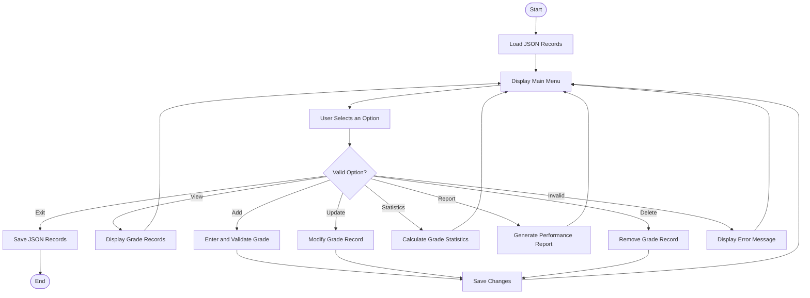

# 📌 PROJECT PROPOSAL
## Student Grade Tracker: An Academic Performance Monitoring and Analysis System

**Team Members:**
1. Brent Silao
2. Martine Plaza
3. Andres Real

---

# PART I. PROJECT OVERVIEW

## 1. Project Title

**Student Grade Tracker: An Academic Performance Monitoring and Analysis System**

## 2. Brief Description

The Student Grade Tracker is a data management application designed to help students record, organize, and monitor their academic grades. The program will allow users to add, view, update, and delete grade records. It will also calculate grade averages and generate academic performance summaries.

The application will use JSON files for persistent data storage, allowing records to be saved and retrieved even after the program is closed.

## 3. Problem Statement

Students receive grades from different subjects and academic activities throughout the school year. Organizing these grades manually can become time-consuming, especially when students need to calculate averages, compare subject performance, and monitor their academic progress.

Without an organized system, students may have difficulty identifying their academic strengths and the subjects that need improvement.

The proposed Student Grade Tracker aims to address this problem by providing a centralized application for managing academic grade records and generating useful performance summaries.

### Target Users / Beneficiaries

- **Students:** Can organize their grades, calculate averages, and monitor academic performance.
- **Teachers:** May use the system to review organized grade records if teacher access is included in the final implementation.

## 4. Project Objectives

The project aims to:

1. Develop an application that allows users to create, read, update, and delete academic grade records.
2. Implement JSON-based persistent data storage to save and retrieve student grade information.
3. Calculate and present meaningful academic statistics, including average, highest, and lowest grades.
4. Provide an organized and user-friendly way to monitor academic performance.
5. Apply Python programming concepts such as functions, arguments, iterative control structures, arrays, and programming libraries.

---

# PART II. PLANNED FEATURES

## 5. Outline of Features

The application will include at least five main features.

| Feature | Description | Persistent Data Used |
|---|---|---|
| 1. Add Grade Records | Allows users to enter student information, subjects, quarters, and grades. | JSON grade records |
| 2. View Grade Records | Displays saved academic records in an organized format. | JSON grade records |
| 3. Update Grade Records | Allows users to modify existing grade information. | JSON grade records |
| 4. Delete Grade Records | Allows users to remove selected grade records. | JSON grade records |
| 5. Calculate Grade Statistics | Calculates average, highest, and lowest grades. | JSON grade records |
| 6. Generate Performance Reports | Presents summaries of academic performance. | JSON grade records |
| 7. Save and Load Records | Saves records to and retrieves records from a JSON file. | JSON file |

## 6. Description of Data to Be Collected and Stored as Persistent Data

The application will use JSON files to store academic information.

| Data Field | Description | Purpose / Use |
|---|---|---|
| Student ID | Unique identification number of a student. | Identifies student records. |
| Student Name | Full name of the student. | Identifies whose grades are recorded. |
| Subject | Name of the academic subject. | Organizes grades by subject. |
| Quarter | Academic quarter associated with the grade. | Groups grades by grading period. |
| Grade | Numerical grade received by the student. | Used for calculations and performance summaries. |

The program will use JSON file operations to save, retrieve, and update records. Input validation will also be applied to help ensure that users enter valid information.

---

# PART III. PLANNED INPUTS AND OUTPUTS

## 7. Planned Inputs and Outputs

### Inputs

The program may accept the following information from users:

- Student ID
- Student name
- Subject name
- Academic quarter
- Numerical grade
- Menu selection for the desired operation

### Outputs

The program will display:

- Saved student grade records
- Updated or deleted record confirmations
- Calculated average grades
- Highest and lowest grades
- Academic performance summaries
- Error messages for invalid inputs
- Notifications when records are successfully saved or loaded

---

# PART IV. LOGIC PLAN

## 8. Logic Plan

The program will use a menu-driven structure to allow users to select different operations.

Functions will be used to organize the program into smaller tasks. Iterative control structures will allow the menu to repeat until the user chooses to exit. Arrays or lists will hold the records during program execution, while JSON files will provide persistent storage.

### Pseudocode

```text
START

Load existing grade records from the JSON file.

REPEAT
    Display the main menu:

        1. Add Grade Record
        2. View Grade Records
        3. Update Grade Record
        4. Delete Grade Record
        5. Calculate Grade Statistics
        6. Generate Performance Report
        7. Exit

    Ask the user to select an option.

    IF the user selects 1:
        Ask for student and grade information.
        Validate the inputs.
        Add the new record.
        Save the records to the JSON file.

    ELSE IF the user selects 2:
        Display all saved grade records.

    ELSE IF the user selects 3:
        Ask which record to update.
        Modify the selected record.
        Save the updated records.

    ELSE IF the user selects 4:
        Ask which record to delete.
        Remove the selected record.
        Save the updated records.

    ELSE IF the user selects 5:
        Calculate average, highest, and lowest grades.
        Display the results.

    ELSE IF the user selects 6:
        Generate and display an academic performance report.

    ELSE IF the user selects 7:
        Save the records.
        Display an exit message.

    ELSE:
        Display an invalid selection message.

UNTIL the user chooses to exit.

END
```

### Sample Flowchart



---

# PART V. SAMPLE WIREFRAME

## 9. Sample Wireframe of the Application

The proposed application will have the following screens:

### Screen 1: Main Dashboard
Displays the main menu and an overview of academic performance.

### Screen 2: Add Grade Record
Provides input fields for student ID, student name, subject, quarter, and grade.

### Screen 3: View Grade Records
Displays all saved student grade records.

### Screen 4: Update and Delete Records
Allows users to select and modify or remove existing records.

### Screen 5: Academic Performance Report
Displays calculated averages, highest grades, lowest grades, and other useful academic summaries.

The wireframe will serve as a visual guide for the planned application interface.

---

# PART VI. TASK SCHEDULE

## 10. Task Schedule and Assigned Team Members

| Task / Activity | Assigned Member(s) | Target Date | Status |
|---|---|---|---|
| Project proposal preparation | Brent, Martine, Andres | To be determined | Completed |
| GitHub repository setup | Brent, Martine, Andres | To be determined | In Progress |
| Application wireframe design | To be agreed upon | To be determined | Pending |
| JSON data preparation | To be agreed upon | To be determined | Pending |
| Program development | Brent, Martine, Andres | To be determined | Pending |
| Program testing and debugging | Brent, Martine, Andres | To be determined | Pending |
| Final documentation | Brent, Martine, Andres | To be determined | Pending |

---

# PART VII. ADDITIONAL CONSIDERATIONS

## 11. Additional Notes / Considerations

The project will consider the following technical requirements:

- **Persistent Data:** JSON files will be used to store and retrieve grade records.
- **CRUD Operations:** The application will support creating, reading, updating, and deleting records.
- **Input Validation:** The program will check user inputs to reduce invalid entries.
- **Data Analysis:** The application will calculate descriptive statistics such as average, highest, and lowest grades.
- **Functions and Arguments:** Functions will organize different program operations.
- **Iterative Control Structures:** Loops will allow users to repeatedly access the main menu.
- **Arrays:** Lists will organize and manage records during program execution.
- **Programming Libraries:** Appropriate Python libraries will be used when necessary.
- **Testing and Verification:** The team will test the program to check whether its features and calculations work correctly.

---

# PART VIII. PROJECT REPOSITORY

## 12. GitHub Repository Link

[Student Grade Tracker - Project Repository](https://github.com/bssilao2031-jpg/Project_Template_ComputerScience2)

The GitHub repository will serve as the central location for storing project documentation, proposal drafts, wireframes, datasets, source code, and other project outputs throughout the succeeding milestones.

**Prepared by:**

Brent Silao  
Martine Plaza  
Andres Real
Group Members:
Brent Silao
Martine Plaza
Andres Real


